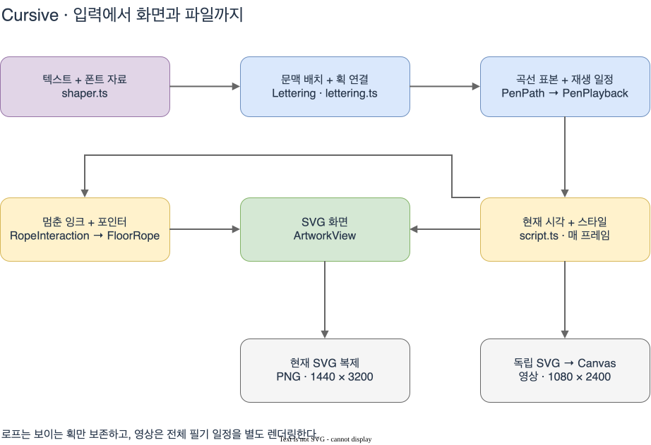
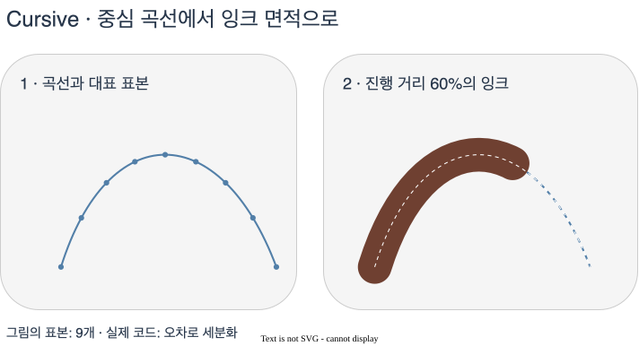

# Cursive 아키텍처

Cursive는 입력한 문장을 연결형 필기체로 쓰고, 멈춘 잉크를 로프처럼 당길 수 있는 SVG 작품이다. Borel 폰트는 글자 선택과 배치를 맡고, 화면의 잉크는 별도로 저작한 펜 중심 경로와 펜촉 너비에서 만들어진다. 이 문서는 현재 코드의 **입력 → 중간 상태 → 렌더 패스 → 출력 → 검증** 순서로 설명한다.



## 1. 이름과 모듈 경계

같은 대상을 코드와 문서에서 아래 이름으로 부른다. `PenStroke`, `PenPath`, `TimedStroke`는 한 획의 서로 다른 처리 단계다.

| 용어 | 코드의 이름 | 의미 |
| --- | --- | --- |
| 텍스트 | `text` | 사용자가 입력한 전체 문자열 |
| 행 | `line`, `Lettering.lines` | 명시적 줄바꿈과 자동 줄바꿈 뒤의 문자열 |
| 글리프 | `ShapedGlyph` | 폰트가 문맥에 따라 고른 글자 형태와 배치 위치. 문자 하나와 항상 일대일로 대응하지 않는다. |
| 저작 획 | `PenStroke` | 편집 가능한 중심 경로 `d`와 펜촉 너비 제어값 |
| 샘플 경로 | `PenPath` | 저작 획을 위치·반지름·누적 거리의 표본으로 바꾼 결과 |
| 시간 획 | `TimedStroke` | 샘플 경로에 시작·종료 시각을 부여한 결과 |
| 재생 일정 | `PenPlayback` | 시간 획 배열과 전체 재생 시간 |
| 잉크 | `ink` | 펜촉이 실제로 지나가면서 남긴 채워진 면적 |
| 로프 | `FloorRope` | 보이는 샘플 경로를 물리 입자와 연결 제약으로 바꾼 상태 |
| 색상 구간 | `GradientPiece` | 원래 누적 거리에 고정된 잉크 색상 구간 |
| 검사 구간 | `StrokeOrderStep` | 긴 획이나 펜을 뗀 이동을 나눈 디버그 구간. 새 저작 획을 뜻하지 않는다. |
| 두께 배율 | `weight` | 저작 너비에 곱하는 사용자 설정. 글자 중심 경로를 확대하는 배율이 아니다. |
| 접촉 배율 | `pressure` | 점을 찍을 때 0에서 1로 커지는 펜촉 반지름 배율 |
| 사진 / 영상 / 파일 | `photo` / `video` / `file` | PNG / 녹화 결과 / 두 형식을 함께 취급하는 공유·다운로드 대상 |

| 모듈 | 책임과 다음 소비자 |
| --- | --- |
| [`script.ts`](../../../pages/cursive/script.ts) | DOM 입력, 재생 상태, 프레임 예약, 로프 전환, 화면 경계와 디버그 UI를 조정한다. |
| [`shaper.ts`](../../../pages/cursive/shaper.ts) | Borel·HarfBuzz·카탈로그·획 자료를 로드하고 `TextShaper`와 `FontCatalog`를 반환한다. |
| [`lettering.ts`](../../../pages/cursive/lettering.ts), [`pen-routing.ts`](../../../pages/cursive/pen-routing.ts) | 텍스트를 배치하고 몸통 획·지연 표식을 연결해 `Lettering`을 만든다. |
| [`stroke-alphabet.ts`](../../../pages/cursive/stroke-alphabet.ts) | 저작 획 계약과 카탈로그에 직접 경로가 없는 글리프의 대체 경로를 정의한다. |
| [`coordinates.ts`](../../../pages/cursive/coordinates.ts) | `Point`, `Matrix`, `Bounds`의 공통 좌표 계약을 정의한다. |
| [`pen-geometry.ts`](../../../pages/cursive/pen-geometry.ts), [`pen-playback.ts`](../../../pages/cursive/pen-playback.ts) | 저작 획을 샘플 경로로 바꾸고 재생 일정과 현재 잉크 면적을 계산한다. |
| [`artwork-view.ts`](../../../pages/cursive/artwork-view.ts) | SVG 레이어와 렌더 캐시를 소유한다. 재생 시각과 스타일, 선택적으로 변형된 로프 경로를 받는다. |
| [`gradient-ink.ts`](../../../pages/cursive/gradient-ink.ts), [`gradient-ink-view.ts`](../../../pages/cursive/gradient-ink-view.ts) | 색상 구간을 만들고 해당 구간의 잉크 면적에 색상 평면을 클리핑한다. |
| [`rope-interaction.ts`](../../../pages/cursive/rope-interaction.ts) | 포인터 캡처·좌표 변환·로프 초기화와 입력 이벤트 해제를 맡는다. |
| [`rope-playback.ts`](../../../pages/cursive/rope-playback.ts), [`rope.ts`](../../../pages/cursive/rope.ts), [`rope-curve.ts`](../../../pages/cursive/rope-curve.ts) | 보이는 획을 동결하고 입자 제약을 풀어 연속적인 변형 경로를 반환한다. |
| [`stroke-order.ts`](../../../pages/cursive/stroke-order.ts), [`stroke-order-view.ts`](../../../pages/cursive/stroke-order-view.ts) | 같은 재생 일정에서 검사 구간과 방향·번호·펜 위치를 만든다. |
| [`export-controls.ts`](../../../pages/cursive/export-controls.ts) | 내보내기 버튼, 진행 상태, 공유 재시도를 위한 준비된 파일을 관리한다. |
| [`photo-export.ts`](../../../pages/cursive/photo-export.ts), [`video-export.ts`](../../../pages/cursive/video-export.ts) | 현재 SVG 사진 또는 독립 재생 영상을 생성한다. |
| [`export-layout.ts`](../../../pages/cursive/export-layout.ts), [`file-share.ts`](../../../pages/cursive/file-share.ts), [`svg.ts`](../../../pages/cursive/svg.ts) | 공통 출력 구도·파일명, 파일 전달, SVG 요소 생성을 한 곳에 둔다. |

## 2. 입력과 좌표 공간

텍스트 입력은 최대 160자이며, ASCII 영문·숫자와 폰트에 있는 일부 기호를 허용한다. `unsupportedCharacters()`는 NFC 정규화 뒤 지원 범위를 검사한다. 악센트 문자와 결합 악센트는 제외한다. 지원하지 않는 입력이면 오류를 표시하고 기존 작품을 유지한다.

일반 입력은 250ms 뒤 다시 조판한다. IME 조합 중에는 기다리고 `compositionend` 뒤 적용한다. `wrapText()`는 명시적 줄바꿈을 보존하고, 긴 행은 단어 단위, 행보다 긴 단어는 코드 포인트 단위로 나눈다. 한 행은 최대 6200 폰트 단위이고 행 간격은 1700 폰트 단위다.

| 공간 / 값 | 단위와 방향 | 변환 위치 |
| --- | --- | --- |
| 폰트 원본 경로 | Borel의 1000 units/em, x는 오른쪽·y는 위쪽 | `pen-paths.json`, 폰트 글리프 경로 |
| 작품 좌표 | 같은 폰트 단위, x는 오른쪽·y는 아래쪽 | `composeText()`의 `[1, 0, 0, -1, origin + glyph.x, lineIndex * 1700 - glyph.y]` |
| `Bounds` | `[left, top, right, bottom]`, 너비·높이 값이 아니다. | 조판, 프레이밍, 내보내기에서 공통 사용 |
| `PenPoint.distance` | 경로 시작부터의 누적 거리, 폰트 단위 | `preparePen()`. 로프 변형 뒤에도 원래 거리값을 유지한다. |
| 포인터·컨트롤 경계 | 화면의 CSS px, y는 아래쪽 | `getScreenCTM().inverse()`로 작품 좌표에 옮긴다. |
| 재생 시각 | 재생 일정의 초 | `strokeState()`가 소비한다. 실제 경과 시간과는 속도 설정으로 연결된다. |
| PNG·영상 해상도 | 출력 파일의 픽셀 | 화면 CSS 크기와 독립적인 Canvas 크기 |

초기화 때 `loadBorel()`은 폰트, 메타데이터와 저작 경로를 가져온다. HarfBuzz는 기본 OpenType 기능으로 문맥형 글리프와 `tt` 합자를 선택한다. 로딩 화면은 첫 조판과 SVG 렌더까지 끝난 뒤 숨긴다. 자료를 불러오지 못하면 입력을 잠그고 재시도 버튼을 표시한다.

## 3. 중간 상태 만들기

### 글리프에서 저작 획으로

연결형 글씨는 같은 문자라도 앞뒤 문자에 따라 진입·출구가 달라진다. `composeText()`는 각 행을 shaping한 뒤 글리프 ID에 맞는 저작 경로를 찾고, 작품 좌표로 배치한다. 원본 폰트의 외곽선은 별도의 `outlines` 배열에 저장한다.

`font-catalog.json`은 글리프 이름·advance·조합 부품을, `pen-paths.json`은 글리프 ID별 펜 경로를 담는다. 획 자료의 주요 필드는 다음과 같다.

| 필드 | 역할 |
| --- | --- |
| `d` | 열린 중심 경로. 펜 샘플러는 절대 `M/L/C` 명령을 읽는다. |
| `widths` | 각 cubic의 시작 너비·두 너비 제어값·종료 너비. 모두 반지름이 아닌 지름이다. |
| `width` | `widths`가 없는 구간의 고정 지름. 생략하면 90 폰트 단위다. |
| `nibScale` | x/y 방향 펜촉 비율. 기본값은 `[1, 1]`이다. |
| `ordered` | 저작한 획 순서와 진행 방향을 보존한다. |
| `mark` | 글리프 자료에서 몸통 뒤로 미루는 점·가로획·두 번째 대각선을 지정한다. |
| `retrace` | 이미 쓴 잉크 위를 펜이 이동하는 구간. 재생 시간은 있지만 새 잉크는 남기지 않는다. |
| `colorAnchors` | 표식이 몸통의 어느 위치에서 색을 가져올지 지정한다. |

`routeWord()`는 글리프의 진입·출구를 연결한다. 순서가 지정된 몸통은 그 순서로 이어 붙이고, 필요한 짧은 연결 구간은 위치·접선·너비를 맞춘다. 짧은 옆 방향 틈은 이전 마지막 cubic의 뒷부분을 다음 진입에 맞춰 작은 S자 연결이 생기지 않도록 한다. 순서가 없는 경로에는 별도의 그래프 경로 선택을 사용한다.

점과 가로획은 단어 몸통 뒤에 그린다. 예를 들어 `i/j`의 점은 자기 몸통의 가까운 위치를, `t/tt` 가로획은 줄기와 만나는 위치를 색상 앵커로 잡는다. 이 관계는 단어 경로를 합치기 전에 정하므로 옆 글자의 높은 획이 점의 색을 가져가지 않는다.

획 형태와 교본 비교에 관한 기존 선택 기록은 [펜 경로 저작 기록](./pen-paths.md)에 둔다.

### 저작 획에서 샘플 경로로

글자의 중심선만 그리면 압력에 따른 두께와 겹친 획의 면적을 표현할 수 없다. `preparePen()`은 중심 위치와 지름 프로파일을 함께 샘플링해, 각 위치에서 펜촉이 차지할 크기를 저장한다.



그림의 왼쪽 점 9개는 읽기 위한 대표 표본이다. 실제 코드는 구간의 1/4·1/2·3/4 위치에서 직선 근사와 실제 곡선의 위치·반지름 차이를 측정한다. 오차가 0.2 폰트 단위 이하이고 구간 길이가 펜촉 크기에 따른 한도 이하면 그 구간을 받아들인다. 아니면 구간을 반으로 나누며, 최대 깊이는 14다. 직선도 짧게 나눠 이미 완성된 잉크의 안티앨리어싱 경계가 매 프레임 크게 바뀌지 않도록 한다.

`PenPath.points`에는 작품 좌표의 `x/y`, 펜촉 `radius`, 누적 `distance`가 들어간다. 같은 중심선 표본을 필기, 획순 검사, 로프와 영상에서 재사용한다.

### 샘플 경로에서 재생 일정으로

`createPenPlayback()`은 이동 거리에 비례해 시간을 나눈다. 움직이는 획의 기본 필기 시간은 총 길이에서 구하며, 0.5초 단위로 반올림하고 4–60초로 제한한다. 이 시간에 펜을 뗀 이동과 점의 접촉 시간이 추가되므로 **전체 재생 시간이 반드시 60초 이하인 것은 아니다.**

서로 떨어진 획 사이에는 0.1–0.32초의 빈 시간을 둔다. 점은 길이 0.1 폰트 단위 이하의 되짚기가 아닌 경로로 판별해 0.16초를 배정한다. 이는 재생 일정 기준이며 기본 속도 2배에서는 실제 시간이 줄어든다.

`strokeState()`는 다음 값을 계산한다.

| 기호 | 코드 | 뜻 |
| --- | --- | --- |
| `t` | `time` | 현재 재생 시각, 초 |
| `s`, `e` | `stroke.start/end` | 해당 획의 시작·종료 시각, 초 |
| `u` | `progress` | 획 안에서의 진행 비율, 0–1 |
| `L` | `stroke.pen.length` | 샘플 경로의 전체 거리, 폰트 단위 |

`u = clamp((t - s) / (e - s), 0, 1)`이고, 쓴 거리는 `written = L × u`다. 이동 획은 접촉 배율 1을 쓰고, 점은 `pressure = u²(3 - 2u)`를 쓴다. 이 곡선은 시작과 끝에서 변화율이 0이므로 점의 접촉 면적이 갑자기 커지거나 멈추지 않는다. `pressure`는 측정된 물리 압력이 아니라 화면의 반지름 배율이다.

`script.ts`는 전체 진행 비율을 유지하며 `progress × playback.duration`을 렌더러에 전달한다. 라이브 재생용 길이는 60Hz 프레임 단위로 올림하고, 실제 프레임 간 경과 시간과 `speed`로 진행 비율을 늘린다. 디버그의 프레임 번호는 이 60Hz 기준값이며 화면 렌더 자체를 60fps로 고정하지 않는다.

## 4. 렌더 패스

여기서 패스는 GPU framebuffer 단계가 아니라 SVG 레이어를 갱신하고 브라우저가 합성하는 순서를 뜻한다.

### 필기 잉크

`ArtworkView`는 SVG의 `defs`, 원본 외곽선, 잉크, 중심 경로 가이드, 획순 검사, 로프 레이어를 소유한다. 텍스트가 바뀔 때 레이어와 캐시를 다시 준비하고, 일반 프레임에서는 필요한 속성만 갱신한다.

단색 잉크는 `penGeometry()`가 만드는 채워진 경로다. 인접 표본의 펜촉 원·타원을 외접선과 원호로 연결해 펜촉이 쓸고 지나간 면적을 만든다. 완성된 짧은 구간은 캐시하고, 현재 끝부분만 쓴 거리와 접촉 배율에 맞춰 계산한다. 되짚기 획은 빈 경로를 반환한다.

펜촉의 화면 반지름은 `radius × nibScale × pressure × weight`다. `weight`를 0.5에서 1.5로 바꾸면 잉크 두께만 바뀐다. `expandPenBounds()`로 처음부터 최대 배율 1.5를 위한 공간을 확보하므로 두께를 조절할 때 viewBox가 다시 확대·축소되지 않는다.

### 그라데이션 잉크

필기가 진행될 때 색 범위를 현재 보이는 길이에 맞춰 다시 늘리면 이미 쓴 색이 바뀐다. `gradientPieces()`는 **완전한 몸통의 원래 누적 거리**에 색상 구간을 고정한다. 지연 표식은 몸통의 앵커 색을 사용하며 그라데이션 총 길이를 늘리지 않는다.

`GradientInkView`는 불투명 색상 사각형을 `linearGradient`로 채우고, 각 구간에서 실제 펜촉이 지나간 면적을 `clipPath`로 제한한다. 뒤의 획이 교차점을 지나갈 때도 자기 펜촉 면적 밖의 오래된 잉크 색을 덮지 않는다. 렌더용 구간은 길이 64 폰트 단위와 방향 변화 0.3 rad를 기준으로 묶되, 내부 위치·너비 표본은 유지한다.

텍스트가 바뀔 때 색상 구간을 준비한다. 매 프레임에는 쓴 거리·접촉 배율·두께가 바뀐 구간만 갱신한다. 로프에서는 원래 거리 구간을 변형된 경로에서 다시 샘플링하고 색상 축을 옮긴다. 색상 앵커를 새 위치의 가장 가까운 글자에 다시 연결하지 않는다.

### 멈춘 잉크와 로프

재생을 멈추거나 끝내면, 획순 검사 중이 아닌 경우 로프 화면으로 전환한다. `visibleRopePens()`는 그 시각까지 쓴 거리만 남기고, 부분 점의 반지름에도 현재 접촉 배율을 반영한다. 아직 시작하지 않은 획은 빈 경로로 남겨 배열의 획 번호와 색상 대응을 보존한다.

`FloorRope`는 경로를 약 20 폰트 단위 간격의 입자로 바꾼다. 일치하는 획 끝점은 공유하고, 가까운 끝점과 다른 획 내부의 접촉은 짧은 연결로 보존한다. 무관한 두 획의 내부가 교차했다는 이유만으로 매듭을 만들지는 않는다.

물리 갱신은 1/120초의 고정 간격으로 실행한다. 이전 위치에서 얻은 속도에 0.86을 곱해 마찰을 주고, 32회의 제약 반복으로 길이와 국소 굽힘을 조정한다. 한 물리 단계의 잡은 점 이동은 120 폰트 단위로 제한한다. 바닥 평면 위에 놓인 로프 모델이므로 중력과 원래 글씨로 돌아가는 스프링은 없다. 손을 놓으면 당긴 형태가 남는다.

`rope-curve.ts`는 입자 위치를 연속 cubic 곡선으로 복원한다. 원래 경로와 휴지 상태 spline 사이의 잔차를 더해 작은 변형에서 글자 형태를 보존하고, 크게 당겼을 때는 이 잔차와 너비의 작은 요철을 줄인다. 변형된 경로에서도 `distance`와 `length`는 원래 재료 좌표를 유지해 색상을 따라 움직이게 한다.

하단 UI가 잉크에 덮이지 않도록, 작품 영역의 아래쪽과 컨트롤의 위쪽 중 높은 경계에서 CSS 12px를 띄워 작품 좌표로 변환한다. solver는 최대 펜촉 반지름과 32 폰트 단위 여유를 더 확보하고, 각 제약 반복 뒤 입자를 경계 안으로 옮긴다. resize와 두께 변경 때도 경계를 갱신한다.

필기를 재개하면 멈춘 시각의 저작 경로로 돌아간다. 완료 뒤 재시작하면 처음부터 쓴다. `requestAnimationFrame`은 필기 중이거나 로프가 움직일 때만 이어지고, 숨겨진 탭에서는 경과 시간을 누적하지 않는다. 포인터 캡처와 로프 이벤트의 해제는 `RopeInteraction.destroy()`가 맡는다.

### 획순 검사

디버그는 `?debug` 또는 입력창 밖의 D 키로 열며 Escape로 닫는다. `StrokeOrderView`는 같은 `PenPlayback`을 읽어 중심 경로, 방향, 검사 번호와 펜 위치를 표시한다. 펜을 뗀 이동은 점선 직선으로 설명하며 실제 잉크를 남기지 않는다.

검사 구간은 긴 획을 거리 기준으로 나눈 것이다. 검사 번호와 저작 획 개수는 다를 수 있다. 검사 중에는 로프를 숨기고 단색 저작 잉크를 낮은 불투명도로 표시한다. 문자·연결 문맥을 선택하면 실제 shaping 결과가 포함된 단어를 다시 조판한다. 검사 레이어는 처음 필요할 때 만들고, 앞뒤로 프레임을 이동해도 같은 시각의 레이어 순서를 복원한다.

## 5. 출력

공개 UI는 텍스트·색상·재생·두께를 제공한다. 사진과 영상 내보내기는 디버그 패널에서 사용한다.

| 출력 | 원본과 처리 | 크기 / 구도 |
| --- | --- | --- |
| 라이브 SVG | 필기 또는 현재 변형 로프 레이어 | 현재 브라우저 영역에 viewBox로 맞춘다. |
| 사진 PNG | 현재 SVG를 즉시 복제한 뒤 이미지로 디코딩해 배경과 합성한다. 멈춘 프레임과 당긴 형태를 보존한다. | 1440 × 3200, 불투명 9:20 이미지 |
| 영상 | 별도의 SVG 렌더러가 전체 재생 일정을 Canvas에 그린다. 현재 플레이어와 로프를 이동시키지 않는다. | 1080 × 2400, 30fps 캡처 요청, 마지막 형태 1초 유지 |
| 소셜 공유 이미지 | 실제 작품 캡처와 별도 제목 합성 | 1200 × 630. [제작 절차](./social-share-image.md) 참고 |

사진과 영상은 `exportViewBox()`로 작품을 가로 80%·세로 44% 안에 맞추고 중앙에 배치한다. 사진에서 로프가 원래 영역 밖으로 당겨졌으면 실제 변형 잉크의 bounds를 쓴다. 일반 컨트롤과 터치 포인터는 SVG 밖에 있어 출력에 포함되지 않는다. 디버그 가이드가 보이는 상태의 사진은 현재 SVG를 복제하므로 그 가이드도 포함할 수 있다.

영상은 `MediaRecorder`가 지원하는 MP4를 우선 선택하고, 지원되지 않으면 WebM을 선택한다. 실시간 SVG 디코딩과 녹화이므로 캡처 요청 빈도가 고정 시간 간격의 모든 프레임을 보장하지는 않는다. 영상 생성 중 탭이 숨겨지면 오류를 표시하고 스트림을 해제한다.

`file-share.ts`는 사진과 영상을 동일한 파일 전달 대상으로 처리한다. iPhone/iPad에서는 파일만 공유 시트로 전달하며, 다른 기기는 다운로드한다. 사용자 활성화가 만료되면 파일을 준비된 상태로 보관해 다시 인코딩하지 않고 다음 버튼 클릭에서 바로 공유한다. 공유 취소는 다운로드로 이어지지 않는다. 실제 iOS 사진 앱 저장과 공유 시트 동작은 물리 기기에서 확인해야 한다.

## 6. 계산 빈도와 검증

| 시점 | 다시 계산하거나 저장하는 값 |
| --- | --- |
| 초기화 | 폰트·카탈로그·저작 경로, SVG 레이어, UI 이벤트 |
| 텍스트 변경 | 줄바꿈·shaping·경로 연결, 샘플 경로, 재생 일정, bounds, 그라데이션 구간 |
| 필기 프레임 | 현재 쓴 거리·접촉 배율, 바뀐 잉크 경로와 clip 경로 |
| 로프 진입 | 보이는 경로와 입자·제약, 로프 SVG 경로 |
| 로프 이동 | 고정 간격 물리 갱신, 변형 곡선과 해당 색상 축 |
| 획순 검사 첫 진입 | 검사 구간과 안내 SVG. 이후에는 활성 구간과 펜 위치 갱신 |
| resize / 두께 변경 | 하단 경계와 펜촉 여유, 바뀐 두께의 잉크 |
| 내보내기 | 사진 snapshot 또는 독립 영상 렌더러, 준비된 공유 파일 |

검증은 원본과 닮았는지, 펜 이동이 맞는지, 색상과 상호작용이 맞는지를 따로 확인한다.

| 검증 대상 | 주요 테스트 |
| --- | --- |
| 폰트 문맥형과 완성 잉크 | `lettering.test.ts`, `word-parity.test.ts`, `word-refit.test.ts`. 지원 글리프의 원본 대비 soft-alpha foreground IoU 95% 기준과 전체 단어·문장 사례 |
| 경로 연결과 저작 순서 | `pen-routing.test.ts`, `cursive-flow.test.ts`, `contextual-flow.test.ts`, `ductus.test.ts`, `lowercase-order.test.ts`, `teaching-model.test.ts` |
| 펜촉 면적·두께·재생 | `pen-geometry.test.ts`, `pen-weight.test.ts`, `pen-playback.test.ts`, `sentence-motion.test.ts` |
| 그라데이션 범위와 앵커 | `gradient-ink*.test.ts`, `gradient-footprint.test.ts`, `gradient-dots.test.ts`, `gradient-crossbars.test.ts`, `h-overlap.test.ts`, `o-overlap.test.ts` |
| 로프의 동결·변형·경계 | `rope.test.ts`, `rope-playback.test.ts`, `rope-gradient.test.ts` |
| SVG 레이어 전환 | `artwork-view.test.ts`. 부분 필기↔로프 전환의 잉크 보존, 텍스트 교체 뒤 레이어 초기화, 획순 앞뒤 탐색 결과 |
| 파일 전달과 영상 일정 | `file-share.test.ts`, `video-export.test.ts`. 파일 단독 공유, 활성화 만료·취소·오류와 형식 선택 |
| 공유 메타데이터 | `social-preview.test.ts` |

```sh
pnpm test pages/cursive
pnpm typecheck
pnpm build
```

실제 렌더링 확인은 기존 Chrome 창에서 필기 중간·완료, 멈춤·재개, 색상·두께, 줄바꿈·오류 입력, 로프 드래그와 획순 검사를 확인한다. 원본 대비 IoU가 높아도 모든 문장의 필기 순서나 교차점 색상이 맞다는 뜻은 아니다. 따라서 경로·시간·색상 회귀 테스트와 실제 화면 검사를 함께 유지한다.

현재 로프는 2D 평면 근사이며 로프끼리의 충돌과 3D 매듭을 계산하지 않는다. 지원 범위 밖의 문자에는 자동 대체 필기체를 만들지 않는다. 이 작품의 구현과 검증 범위에 관한 문서는 이 디렉터리에, 여러 작품에서 재사용할 원리는 별도의 `docs/concepts/`에 둔다.

도식 편집 원본은 `docs/assets/cursive-pipeline.drawio`, `docs/assets/cursive-nib.drawio`에 있다. VS Code의 draw.io 확장 또는 draw.io 앱에서 열어 편집하고 SVG를 다시 export한다. 정밀 곡선 원본은 `docs/assets/cursive-nib-geometry.svg`이며 draw.io에 데이터로 포함되어 있다.
