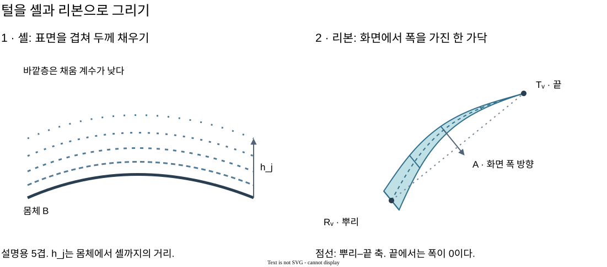

# 솜결은 어떻게 만들었을까?

솜결을 구현할 때 풀어야 할 큰 문제는 세 가지다. **화면에서 누른 곳을 입체 몸체에서 찾기**, **몸체를 부드럽게 움직이기**, **그 몸체 위에 털을 표현하기**다.

이 문서는 각 문제가 왜 생기고, 어떤 방식으로 해결했는지를 설명한다. [웹 문서](./index.html)에서는 터치 광선, 셸과 리본을 직접 조작하며 같은 내용을 볼 수 있다.

## 1. 화면에서 누른 곳을 3D 몸체에서 어떻게 찾을까?

손가락이 알려주는 것은 화면 위의 가로·세로 위치다. 하지만 캐릭터는 깊이가 있는 입체다. 화면의 같은 위치에도 앞쪽 표면, 뒤쪽 표면, 그 사이의 공간이 겹쳐 보인다. 터치 좌표만으로는 깊이를 알 수 없다.

솜결은 **누른 화면 위치를 통과하는 가상의 광선**을 만든다. 카메라가 그 위치에서 바라보는 방향으로 광선을 보내고, 몸체 표면과 처음 만나는 점을 찾는다. 이 방법을 레이캐스팅(ray casting)이라고 한다.

실제 처리는 다음 순서다.

1. 손가락 위치가 작품 화면 안에서 어디에 있는지 구한다.
2. 현재 카메라를 기준으로 그 위치를 통과하는 광선을 만든다.
3. 지금 변형된 몸체와 광선이 만나는 가장 앞쪽 점을 찾는다. 만나지 않으면 몸체를 누른 것으로 처리하지 않는다.
4. 만난 점의 위치와 표면이 향하는 방향을 저장한다.

접촉 위치는 캐릭터 자체를 기준으로 한 좌표로 바꿔 저장한다. 캐릭터가 화면에서 어디에 놓였는지, 얼마나 회전했는지와 몸체 안에서 어디를 눌렀는지를 구분하기 위해서다.

표면이 향하는 방향은 **법선**이라고 한다. 이 방향을 알아야 옆면을 눌렀을 때도 그 면 안쪽으로 움푹 들어가게 할 수 있다.

접촉 검사는 털 한 가닥마다 하지 않고 몸체 표면에 한다. 이렇게 하면 많은 털 사이에서 접촉점을 찾는 비용을 줄이고, 하나의 몸체 접촉점으로 몸체와 털의 반응을 함께 만들 수 있다.

아래 데모에서 몸체의 가운데와 옆면, 몸체 밖을 눌러 보자. 화면에서 같은 방식으로 눌러도 광선이 몸체와 만나는지에 따라 접촉점이 생기거나 생기지 않는다.

<!-- interactive-demo: touch -->

## 2. 몸체 전체를 계산하지 않고 어떻게 부드럽게 움직일까?

먼저 작은 삼각형들로 연결된 구를 만든다. 구 표면의 점을 캐릭터 외곽선과 깊이에 맞춰 옮기면, 화면에서는 원하는 실루엣이 보이면서 회전할 수 있는 입체 몸체가 된다.

이 몸체의 모든 점에 움직임을 따로 지정하는 것은 어렵다. 솜결은 몸체의 중심과 둘레에 **움직임을 조절하는 기준점**, 즉 변형 컨트롤을 둔다.

표면의 각 점은 주변 컨트롤 여러 개의 영향을 받는다. 가까운 컨트롤을 더 많이 따라가고, 먼 컨트롤을 덜 따라간다. 컨트롤 하나를 움직이거나 돌리면 주변 표면도 함께 움직인다.

여러 영향을 섞는 이유는 경계에서 몸체가 꺾이지 않게 하기 위해서다. 한 점이 오직 하나의 컨트롤만 따라가면 이웃 점과 다른 방향으로 움직여 틈이나 급한 꺾임이 생길 수 있다. 주변 컨트롤의 이동을 조금씩 나눠 따라가게 하면 변화가 넓은 영역에 걸쳐 이어진다.

자동 움직임은 이 컨트롤들이 시간에 따라 이동하는 것으로 만든다. 원본 캐릭터는 미리 측정한 외곽선 움직임을 따라가고, 다른 캐릭터는 위치마다 조금 다른 시점에 바람을 따라 움직인다. 실행 중에 영상에서 몸체를 다시 찾아내지는 않는다.

### 누른 부분만 움푹 들어가게 하기

자동 움직임으로 만든 몸체에 터치 반응을 추가한다. 접촉점에 가까운 표면은 많이 움직이고, 멀리 있는 표면은 적게 움직인다. 이동 방향은 앞에서 저장한 표면 법선의 안쪽이다.

누르는 동안에는 눌림이 서서히 커진다. 손을 떼면 눌림이 줄어들고 짧은 반동이 생긴다. 접촉점에서 먼 곳은 반동이 조금 늦게 도착하도록 만들어, 반응이 주변으로 퍼지는 느낌을 준다.

드래그는 캐릭터 전체를 돌리는 입력으로 전환한다. 두 손가락으로 벌리거나 모으면 카메라의 확대 배율을 바꾼다. 이렇게 눌림, 회전, 확대를 서로 다른 반응으로 처리한다.

## 3. 매끈한 몸체 위에 털을 어떻게 표현할까?

몸체에 잔무늬만 그리면 거친 표면은 만들 수 있어도, 외곽선 밖으로 솟는 털은 생기지 않는다. 반대로 가느다란 털만 많이 놓으면 가닥 사이로 몸체가 드러나고, 솜처럼 꽉 찬 느낌을 만들기 어렵다.

솜결은 **두께를 채우는 셸**과 **가닥을 보여주는 리본**을 함께 사용한다.

### 셸: 털 사이의 공간을 채우기

셸(shell)은 몸체 표면을 복제해 조금씩 바깥으로 옮긴 얇은 층이다. 여러 층을 겹치면 몸체 밖에도 색과 두께가 생긴다.

각 층을 매끈하고 불투명하게 그리면 가장 바깥 표면만 보인다. 그래서 불규칙한 무늬를 이용해 층마다 보이는 부분과 비어 있는 부분을 만든다. 안쪽은 촘촘하게, 바깥쪽은 성기고 투명하게 그린다. 층 사이로 다른 층이 보이면서 속이 차 있고 가장자리는 가벼운 털 덩어리처럼 보인다.

안쪽 층을 더 촘촘히 배치하면 몸체 가까이에 두께를 집중할 수 있다. 아래 데모의 곡선 하나는 한 가닥이 아니라, 이 얇은 층 하나의 단면이다.

<!-- interactive-demo: shells -->

### 리본: 외곽에서 한 가닥이 보이게 하기

리본(ribbon)은 뿌리와 끝을 잇는 가늘고 긴 띠다. 뿌리 쪽에 폭을 주고 끝으로 갈수록 좁히면 털 한 가닥처럼 보인다. 가운데를 조금 휘게 하고 길이와 기울기에 차이를 주면 가닥들이 같은 모양으로 늘어서는 것을 피할 수 있다.

얇은 띠에는 다른 문제가 있다. 옆에서 보면 폭이 사라져 거의 보이지 않는다. 솜결은 가닥의 뿌리와 끝이 화면에서 어디에 보이는지 먼저 구한 뒤, **그 화면 방향에 수직으로 띠의 폭을 펼친다.** 캐릭터를 돌려도 띠의 넓은 면이 카메라를 향하게 만드는 방법이다.

다만 가닥 자체가 카메라를 향하면 뿌리와 끝이 겹쳐 보여 길이는 짧아진다. 셸이 함께 있기 때문에 이런 가닥들 사이에도 털 덩어리의 두께가 남는다.

<!-- interactive-demo: ribbons -->

## 4. 몸체가 움직일 때 털이 떨어지지 않게 하려면?

털을 공간에 따로 놓으면 몸체만 움직이고 털은 남아 버린다. 그래서 각 가닥의 뿌리를 몸체 표면에 붙이고, **그 표면을 움직이는 컨트롤의 영향을 털에도 공유**한다.

털의 뿌리와 끝은 같은 컨트롤들을 따라 움직인다. 끝이 별도의 컨트롤을 따라가면 몸체 변형만으로 가닥이 과하게 늘어나거나 꺾일 수 있기 때문이다. 셸도 매 순간 변형된 몸체를 기준으로 다시 배치한다.

누를 때는 몸체와 털 뿌리를 함께 옮기되, 털끝은 조금 덜 움직인다. 드래그할 때는 털끝이 뒤로 남는 듯한 기울기도 더한다. 이 차이가 몸체 위의 털이 눌리고 쓸리는 인상을 만든다.

## 5. 이 계산들이 어떻게 하나의 화면이 될까?

한 프레임에서는 먼저 자동 움직임과 터치 상태를 구하고, 그 결과로 몸체를 변형한다. 이어 몸체를 따라 셸과 털 가닥을 옮긴다. 그 상태에서 배경과 몸체, 겹친 셸, 개별 가닥, 눈을 차례로 그린다.

몸체와 털에는 같은 표면색을 사용해 서로 이어진 물체처럼 보이게 한다. 표면 방향에 따른 밝기 차이와 바닥 그림자가 입체감을 주고, 화면에 약한 흐림 효과를 더해 날카로운 가닥 경계를 부드럽게 만든다.

이 방식이 잘 작동하는지는 누르거나 돌려 보면서 확인할 수 있다. **누른 곳 주변이 반응하는지, 몸체를 돌려도 털이 붙어 있는지, 외곽의 가닥과 안쪽의 두께가 함께 보이는지**가 핵심이다.

실제 솜의 모든 물리를 계산하는 방식은 아니다. 털끼리 부딪히는 현상이나 섬유 안에서의 빛 산란은 생략하고, 부드러운 두께·개별 가닥·터치 반응을 조합해 솜 같은 인상을 만든다.
